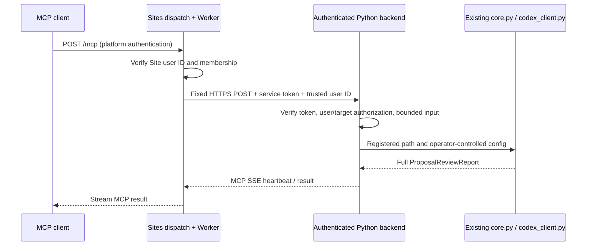

# Sites MCP deployment

## Runtime and ownership

Sites runs the dependency-free Worker ESM adapter in `sites/`. The Python backend
runs on an operator-controlled host with proposal files and the existing Codex
SDK authentication. Workers cannot execute that local runtime or read a PC's
filesystem. A Worker alone is therefore insufficient.



The CLI and stdio tool implementations remain in `mcp_server.py`; remote wrappers
reuse their signatures and implementations. `core.py` still owns orchestration,
`models.py` owns reports, and `codex_client.py` owns SDK integration. No review
lens, report field, source provenance, folder filtering, or language/search mode
is removed. Existing local path/config behavior remains available locally.

## Authority and remote contract

Sites dispatch owns OAuth and injects `oai-authenticated-user-id`. Only deploy
this Worker behind Sites dispatch; direct access to an untrusted proxy that can
forge the identity header is unsupported. Each Site has different user IDs.
The Worker checks `PROPOSAL_DOCTOR_ALLOWED_USER_IDS` and overwrites the backend
identity header; it never forwards caller cookies or bearer credentials.
Service access without a Site user receives 401. A shared backend bearer token
authorizes the bridge, not access to any particular user's documents. The backend
independently requires that user in the target's `users` list. Use a distinct
backend instance/token/registry per Site and user access scope; token holders are trusted bridge
operators who can assert identities, not ordinary MCP users.

All targets in one backend must have the same user grant set; mixed tenant
registrations fail startup. Per-target authorization still runs for every call.
Use separate isolated backend hosts for groups with different access rights.

Remote tools keep the existing names and field types/defaults:

| Field | Remote restriction | Local CLI/stdio |
| --- | --- | --- |
| `path` | Opaque registered target ID, up to 64 characters | Local path |
| `repo` | Only default `.` accepted; substituted with target workspace | Local working directory |
| `codex_config_overrides` | Only omitted/null/empty accepted | Runtime overrides |
| `max_parallel` | Integer 1..10, at most operator limit | Existing behavior |
| `audience` | 1..1000 characters | Existing behavior |
| `language`, `web_search` | Existing enums and defaults | Existing behavior |

Discovery contains only public tool descriptions/schema, never the target
registry or filenames. Operators share allowed target IDs out of band; there is
no public filesystem browser, shell, runtime executable, arbitrary URL, upload,
or target-registration tool. All three tools return the original JSON report in
MCP text content. Folder reviews remain aggregated, without pagination; tool
discovery has only three entries. Input/output schemas are checked against local
stdio fixtures, while additional remote restrictions are enforced and described.

Wrong identity or target access returns HTTP 401/403 before execution. Invalid
tool arguments and review failures use MCP `isError`; runtime exceptions are
sanitized. Legacy negotiation/calls use the official Python MCP SDK. The HTTP
boundary adds `2026-07-28` discovery/per-request metadata without changing local
library/stdio. Modern JSON/SSE results receive `resultType: complete` and
`_meta['io.modelcontextprotocol/serverInfo']`, preserving report contents and
heartbeats; legacy envelopes remain unchanged. Initialization
notifications return empty 202; GET/DELETE receive 405 because this server offers
no standalone SSE stream or persistent sessions. No `MCP-Session-Id` is created.
Body size is bounded at 16 KiB at both boundaries. Only one review can run per
backend process, with a 15 minute overall deadline. A busy error means retry
after the running review completes. There is no persistent job/replay store;
repeating a call starts another inference and can incur additional Codex usage.

### Modern HTTP compatibility

`server/discover` returns the actual modern version plus SDK-supported legacy
versions, `capabilities: {"tools": {}}`, `resultType: "complete"` and server
identity in `_meta`. Tools and ping are exposed for modern calls; sampling,
elicitation, subscriptions and MRTR are not advertised. The bridge token and
permitted Site user are required even for discovery. Discovery/tool listing
need no API key or Codex inference, making them short keyless live test candidates.

Modern requests carry `params._meta` with
`io.modelcontextprotocol/protocolVersion: "2026-07-28"` and
`io.modelcontextprotocol/clientCapabilities: {}` (or declared capabilities).
`clientInfo` is optional. `MCP-Protocol-Version` and `Mcp-Method` must match the
body; tools/call also requires matching `Mcp-Name`, including Base64-sentinel
decoding. The Worker forwards these headers without inventing them. Missing or
invalid metadata returns HTTP 400 / -32602; header mismatch returns 400 / -32020;
unknown versions return 400 / -32022 with supported/requested versions; unknown
modern methods return 404 / -32601.

A bare `server/discover` probe with `params: {}` and no version header (or the
modern version header) is tolerated only for discovery bootstrap. It receives
actual supported versions; subsequent modern calls must meet the metadata/header
contract. Legacy versions still use their existing initialize flow. The HTTP
boundary internally selects the SDK's legacy `2025-11-25` transport and adds
modern envelopes per JSON/SSE event. It uses the same registered tools/auth/core.
Deploy both the updated backend and Worker: an older backend cannot interpret
server/discover just because the Worker forwards it. No SDK major upgrade is needed.

## Backend setup

Use Python 3.11–3.13 and `uv`. Prefer one dedicated host/account per trust scope
with only approved proposals/supporting files accessible. Codex's read-only
sandbox prevents writes; it is **not** a per-target read-access sandbox. Target
registration restricts requested paths, not every file the model might attempt
to read. Do not run remote review against your general personal account/home.
Filesystem permissions or an isolated execution host must exclude unrelated
private files and other tenants. Keep bridge secrets, tunnel credentials and
registration files outside registered workspaces. Codex authentication remains
on the backend using its supported authentication mechanism; never read/copy auth
files to the Worker or include credentials in proposal files or prompts.

1. Check out the reviewed revision on that host and run:

   ```bash
   uv sync --locked --extra remote
   ```

2. Copy `deploy/remote-targets.example.json` to an ignored `remote-targets.json`
   outside the proposal workspace. Replace workspaces, relative proposal paths,
   Site-scoped user IDs and allowed backend Host header values. On Windows use
   JSON-escaped absolute paths. Targets and their directories must be
   operator-controlled, with no filesystem links or concurrent untrusted
   replacements. Paths are checked at startup and before every review. To reduce
   concurrency, set `max_parallel` and pass a matching value in tool calls.
   The only server-side runtime override supported here is
   `stream_idle_timeout_ms`, an integer between 1000 and 900000.

3. Supply these environment names using your host's secret manager/service
   environment (examples contain names only):

   - `PROPOSAL_DOCTOR_BACKEND_TOKEN`: private random printable ASCII token, at least 32
     characters, no whitespace; shared only with this Site's Worker.
   - `PROPOSAL_DOCTOR_TARGETS_FILE`: absolute path of the registry.

   Start `uv run --locked --extra remote proposal-doctor-backend`. It binds only
   `127.0.0.1:8765`, disables access logs and strips bridge environment variables
   before launching Codex children. Keep this single process supervised by your
   existing service manager. Restart to apply registry/token changes. The app
   factory is for tests; use this entry point for production secret handling.

4. Provide stable HTTPS forwarding of `/mcp` to that loopback service. The
   included `deploy/cloudflared.example.yml` supports an existing named
   Cloudflare Tunnel/domain and rejects other paths. Use an operator-private
   configuration with your existing tunnel ID and credential file, then run:

   ```bash
   cloudflared tunnel --config /private/cloudflared.yml ingress validate
   cloudflared tunnel --config /private/cloudflared.yml run
   ```

   The public hostname must be routed to that tunnel through its existing DNS
   configuration. Alternatively use your existing HTTPS reverse proxy with
   streaming enabled. Authentication is enforced by this backend even though
   the HTTPS hostname is network-reachable. Do not add browser login redirects
   or response buffering in front of `/mcp`. The SDK emits SSE keepalives and the
   Worker streams them; verify timeout/streaming behavior with the actual chosen
   infrastructure. This PR creates no tunnel, domain, account or paid service.

## Sites source, secrets and packaging

Use `sites/` as the Site source root, never the Python backend checkout/registry.
No npm dependencies are required. The build matches the official Worker ESM
starter: `dist/server/index.js` has `default.fetch`, and
`dist/.openai/hosting.json` declares `capabilities: ["mcp"]`. D1/R2 are unused.

```bash
cd sites
node --test tests/worker.test.mjs
node scripts/build.mjs
node scripts/validate-artifact.mjs
tar -czf /absolute/private/proposal-doctor-site.tgz -C dist .
```

The tracked manifest intentionally has no invented Site ID. For a later
authorized deployment, open/register through the official Sites workflow,
persist its returned `project_id` in the source manifest and preserve all
existing identity/audience fields when updating. Configure these runtime secret
names with native Sites tools; do not put their values in source, a manifest,
browser bundles, shell command arguments, logs or model prompts:

- `PROPOSAL_DOCTOR_BACKEND_URL`: fixed `https://<backend-host>/mcp`, no credentials,
  query or fragment. Only the operator can set this destination.
- `PROPOSAL_DOCTOR_BACKEND_TOKEN`: matches the backend's secret.
- `PROPOSAL_DOCTOR_ALLOWED_USER_IDS`: JSON array of permitted Site-scoped IDs.

For source workflow packaging, checks/builds are the same argument arrays above
without the manual tar step. Use the Sites source helper from the installed
official skill to commit/push source and create its archive; pass source
credentials only through stdin. Then save/deploy using native Sites tools and
the same Site ID, keeping a new Site private. No separate OAuth stack or MCP
registration is needed. A deployment is not proof of authenticated discovery:
check `get_site(include_mcp_connection: true)`, its `has_mcp`/plugin metadata,
connect through the platform-managed plugin, then test discovery and a review
of a synthetic registered target. Report each result independently. These steps
are documentation for a subsequent authorized deployment, not actions this PR
has performed.

## Reproducible checks and cleanup

```bash
uv run --locked --extra dev --extra remote pytest
uv run --locked --extra dev --extra remote ruff check .
uv build
node --test sites/tests/worker.test.mjs
node sites/scripts/build.mjs
node sites/scripts/validate-artifact.mjs
```

`tests/test_remote.py` uses isolated temporary proposal fixtures and replaces only
the Codex inference boundary. The real core, all lenses, report models, local
tool implementations, MCP SDK HTTP transport and authorization run. Worker tests
mock HTTPS but check headers, identity separation, redirects, body bounds and
stream preservation. CI runs these checks on Linux, including symlink rejection.
`tests/test_http_protocol.py` reproduces the unmodified SDK's actual HTTP 200 /
-32602 discovery failure and checks modern discovery/list/all three calls with
real SDK results, protocol errors and legacy interoperability. The loopback test
also launches `sites/tests/backend-flow.mjs`: the actual Worker runs against the
real backend with only Codex inference stubbed, verifying discovery/tool calls
rather than an invented discovery response. Split UTF-8 SSE frames and incremental
heartbeat delivery are checked separately.
No real Codex login/API call, production data or cloud resources are needed.

Windows local validation: 56 Python tests passed, one symlink test skipped due
to OS privilege; five Node checks passed. This is
local/mock evidence, not Sites dispatch, OAuth or live tunnel acceptance. An
official MCP ClientSession also initializes, discovers and reviews a synthetic
folder over an owned loopback HTTP server, which is stopped in a `finally` block.
CI and final review status are recorded in the PR. Hosted discovery/calls for this
source revision, long-running network streaming and live Codex inference remain
separate acceptance steps.
Starlette emits an upstream TestClient/httpx deprecation warning; no dependency
upgrade is included for that warning.

Tests close TestClient/thread pools automatically. After verification, remove
only this run's temporary fixtures, generated Python/Sites dist, local test
environment and caches; preserve source/worktree/tests for review. Shared caches
and existing Sites/tunnels/plugins/data must remain untouched. No external
verification resources are created by this workflow.

## References checked 2026-10-10

- Installed Sites 1.0.0 `site-mcp-server.md`, `identity-and-secrets.md`, and Worker
  ESM starter: stateless POST `/mcp`, platform identity/OAuth, runtime secrets,
  Worker archive layout. The implementation follows these local platform docs.
- [MCP Streamable HTTP, 2025-11-25](https://modelcontextprotocol.io/specification/2025-11-25/basic/transports)
  and [lifecycle](https://modelcontextprotocol.io/specification/2025-11-25/basic/lifecycle).
- [Modern discovery](https://modelcontextprotocol.io/specification/2026-07-28/server/discover),
  [per-request metadata](https://modelcontextprotocol.io/specification/2026-07-28/basic),
  [version compatibility](https://modelcontextprotocol.io/specification/2026-07-28/basic/versioning)
  and [HTTP validation](https://modelcontextprotocol.io/specification/2026-07-28/basic/transports/streamable-http).
- [Official Python MCP SDK v1](https://github.com/modelcontextprotocol/python-sdk/tree/v1.x),
  tested at the lockfile's 1.28.1. The remote extra sets this compatible minimum;
  the local base dependency remains unchanged.
- [Codex SDK](https://developers.openai.com/codex/sdk/); the repository retains
  `openai-codex` 0.144.4 and its existing Python integration. Public overview
  examples do not replace that checked-in Python API contract.
- [Cloudflare Tunnel](https://developers.cloudflare.com/cloudflare-one/networks/connectors/cloudflare-tunnel/)
  and [configuration/ingress](https://developers.cloudflare.com/cloudflare-one/networks/connectors/cloudflare-tunnel/do-more-with-tunnels/local-management/configuration-file/).
