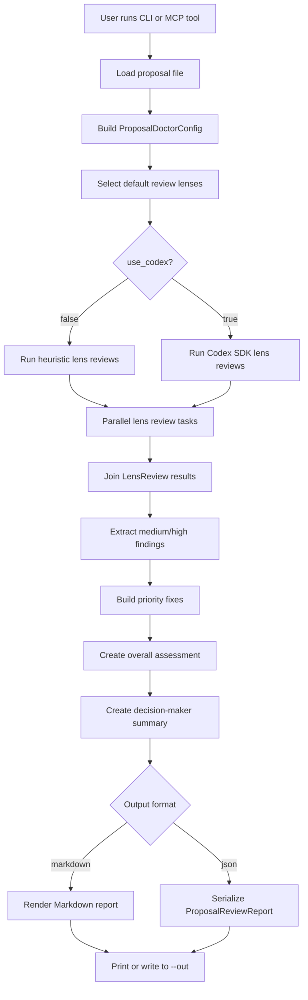
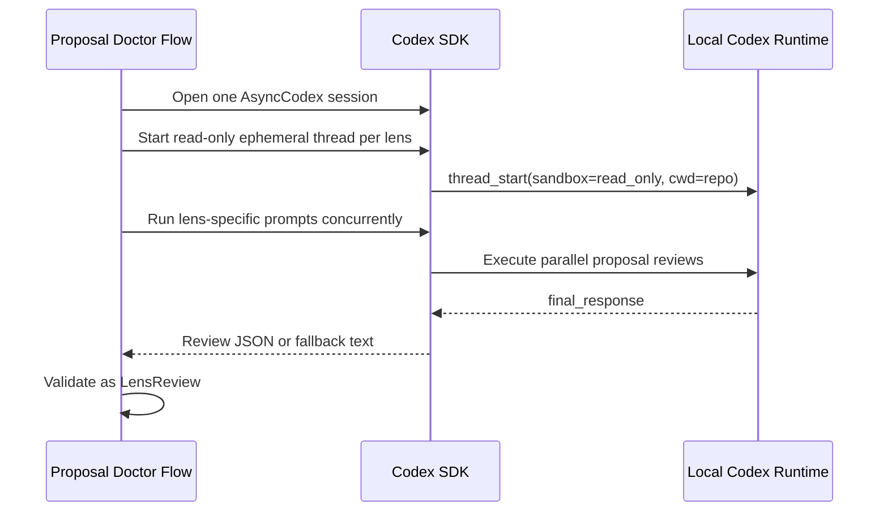

# Proposal Doctor Specification

## Purpose

Proposal Doctor is a focused local tool for reviewing proposal drafts before they
are sent to customers, executives, or procurement teams.

The tool runs a proposal through multiple business lenses, aggregates the
findings, and returns a prioritized improvement report. It supports a safe local
heuristic mode by default and an optional Codex-backed mode for deeper document
review.

## Target Users

- Account executives preparing customer proposals
- Sales engineers reviewing technical or implementation claims
- Founders and consultants preparing high-stakes proposals
- Customer success or delivery leads validating implementation promises
- Internal teams preparing approval, procurement, or renewal documents

## Primary Jobs

1. Identify weak points in a proposal before it is sent.
2. Review the same draft from multiple decision-maker perspectives.
3. Convert broad critique into prioritized edits.
4. Produce a report that can be shared with a seller, reviewer, or proposal owner.
5. Provide the same review capability through CLI and MCP.

## Non-Goals

- Full proposal generation from scratch
- CRM integration
- Document layout editing
- Legal advice or contract approval
- Replacement for human deal review
- Long-term document storage

## Interfaces

### CLI

```bash
proposal-doctor review proposal.md
proposal-doctor review proposal.md --audience "enterprise CFO"
proposal-doctor review proposal.md --format json
proposal-doctor review proposal.md --out review.md
proposal-doctor review proposal.md --use-codex --repo .
```

### MCP

The MCP server exposes a `review_proposal_file` tool.

Inputs:

- `path`: local proposal file path
- `audience`: intended buyer or reviewer audience
- `use_codex`: whether to ask Codex SDK for deeper lens reviews
- `repo`: local working directory used by Codex
- `max_parallel`: maximum concurrent lens reviews

Output:

- JSON-compatible `ProposalReviewReport`

## Review Lenses

Proposal Doctor uses five default lenses.

| Lens | Purpose |
| --- | --- |
| `customer` | 顧客視点。課題、導入価値、緊急度、信頼性を確認する。 |
| `decision_maker` | 決裁者視点。承認判断、事業価値、リスク、意思決定材料を確認する。 |
| `finance` | 財務視点。価格、ROI、予算前提、回収期間、測定方法を確認する。 |
| `execution_risk` | 実行リスク視点。体制、責任分界、スケジュール、依存関係を確認する。 |
| `competitive` | 競合比較視点。代替案との差別化、比較軸、勝ち筋を確認する。 |

## Execution Flow



## Codex-Backed Review Flow



## Data Model

### `ProposalDoctorConfig`

- `audience`: target reader, default `enterprise buyer`
- `use_codex`: enables Codex SDK review path
- `repo`: working directory for Codex
- `max_parallel`: review concurrency limit

### `LensReview`

- `lens`: review lens name
- `summary`: short lens-specific assessment
- `findings`: structured issues found for that lens
- `questions`: questions the proposal owner should answer

### `ReviewFinding`

- `lens`: originating lens
- `severity`: `low`, `medium`, or `high`
- `title`: concise issue title
- `rationale`: why the issue matters
- `recommendation`: concrete fix

### `ProposalReviewReport`

- `source`: reviewed file path
- `audience`: intended audience
- `overall_assessment`: high-level readiness statement
- `lens_reviews`: all lens results
- `priority_fixes`: top fixes to make before sending
- `decision_maker_summary`: concise summary for a reviewer or manager

## Operating Modes

### Heuristic Mode

Default mode. Runs local checks without model calls.

Strengths:

- Fast
- Works offline after installation
- Safe for smoke testing and baseline review

Limitations:

- Shallow
- Pattern-based
- Cannot reason deeply about the proposal's specific context

### Codex Mode

Enabled with `--use-codex`. Proposal Doctor opens one Codex SDK session, starts
a read-only ephemeral thread for each review lens, and runs those lens reviews
concurrently up to `max_parallel`.

Strengths:

- Better document-specific critique
- Can account for repo-local context when relevant
- Preserves a clear flow boundary around each review lens

Limitations:

- Requires Codex login or configured Codex authentication
- Slower than heuristic mode
- Model output may need schema fallback handling

## Concurrency Model

Proposal Doctor treats each review lens as an independent task. The flow can run
lens reviews concurrently and join the results into one report.

The current implementation uses `asyncio.gather` with a semaphore. In Codex mode,
the gathered tasks call Codex SDK and each task owns one lens-specific Codex
thread. In heuristic mode, the same concurrency boundary runs local checks.

A future implementation can move the same shape into Pydantic Graph `map()` and
`join()` nodes once the flow needs richer state transitions, retries, or partial
results.

## Package Shape

```text
src/proposal_doctor/
  cli.py          CLI entry point
  mcp_server.py   MCP server entry point
  core.py         review orchestration and rendering
  models.py       Pydantic data models
  lenses.py       default review lenses
  heuristic.py    local first-pass reviewer
  codex_client.py Codex SDK integration
```

## MVP Constraints

- Proposal input is UTF-8 text or Markdown.
- `.docx` and PDF parsing are intentionally out of scope for the first version.
- Heuristic mode is not intended to be a complete proposal reviewer.
- Codex mode starts read-only.
- The tool does not write edits back into the proposal draft.

## Future Extensions

- Pydantic Graph implementation with explicit `map()` and `join()` nodes
- `.docx` and PDF extraction
- Redline-style edit suggestions
- Custom review lens configuration
- Deal-stage-specific review presets
- MCP resources for reusable proposal templates
- JSON schema export for downstream workflow tools
