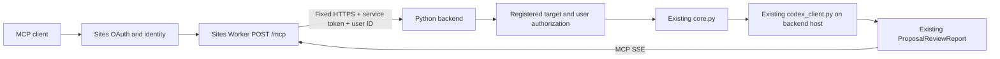
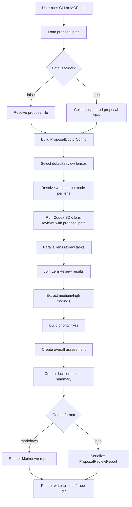
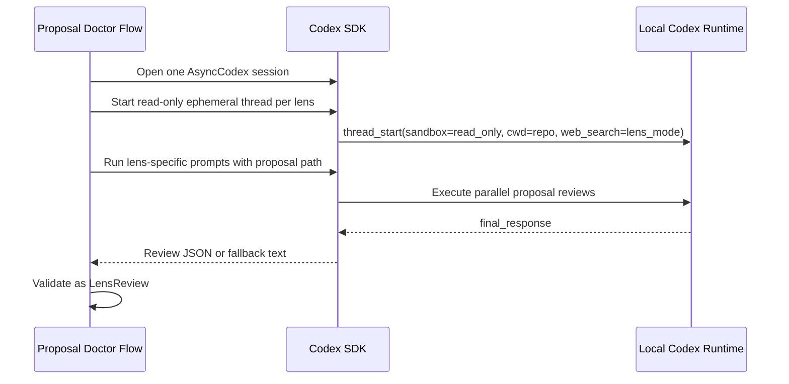

# Proposal Doctor Specification

## Purpose

Proposal Doctor is a focused local tool for reviewing proposal drafts before they
are sent to customers, executives, or procurement teams.

The tool runs a proposal through multiple business lenses with Codex, aggregates
the findings, and returns a prioritized improvement report.

## Target Users

- Account executives preparing customer proposals
- Sales engineers reviewing technical or implementation claims
- Founders and consultants preparing high-stakes proposals
- Customer success or delivery leads validating implementation promises
- Internal teams preparing approval, procurement, or renewal documents

## Primary Jobs

1. Identify weak points in a proposal before it is sent.
2. Review the same draft from multiple decision-maker perspectives.
3. Convert broad critique into prioritized edits.
4. Produce a report that can be shared with a seller, reviewer, or proposal owner.
5. Provide the same review capability through CLI and MCP.

## Non-Goals

- Full proposal generation from scratch
- CRM integration
- Document layout editing
- Legal advice or contract approval
- Replacement for human deal review
- Long-term document storage

## Interfaces

### CLI

```bash
proposal-doctor review proposal.md
proposal-doctor review ./proposal-folder
proposal-doctor review proposal.md --audience "enterprise CFO"
proposal-doctor review proposal.md --language ja
proposal-doctor review proposal.md --web-search disabled
proposal-doctor review proposal.md --format json
proposal-doctor review proposal.md --out review.md
proposal-doctor review proposal.md --out-dir .work
proposal-doctor review proposal.md --repo .
proposal-doctor review proposal.md --codex-config stream_idle_timeout_ms=900000
```

### MCP

The MCP server exposes these review tools:

- `review_proposal_file`: review one local proposal file
- `review_proposal_path`: review either one local file or one local folder
- `review_proposal_folder`: review one local folder of proposal files

Inputs:

- `path`: local proposal file or folder path
- `audience`: intended buyer or reviewer audience
- `language`: output language for human-readable review fields, `en` or `ja`
- `web_search`: web search policy, `lens`, `disabled`, `cached`, or `live`
- `repo`: local working directory used by Codex
- `max_parallel`: maximum concurrent lens reviews, default `10`
- `codex_config_overrides`: optional Codex runtime `key=value` overrides

Output:

- JSON-compatible `ProposalReviewReport`

## Sites remote MCP

The local MCP contract above remains unchanged. An additional Sites Worker ESM
adapter exposes stateless `POST /mcp` through an authenticated Python backend.
See [SITES.md](SITES.md) for the complete deployment and access contract.
Remote calls retain all three tool names, argument fields and report models.
`path` is a registered target ID; `repo` must remain `.` and runtime overrides
must be empty. The backend substitutes its registered workspace and bounded
operator configuration, verifies Site-user access per target, and reuses the
existing review functions. The full ten-lens review and provenance are preserved.

The HTTP boundary implements modern `server/discover` and `2026-07-28` per-request
metadata/header validation, adapting real SDK v1 JSON/SSE results to modern
`resultType`/server identity envelopes. The Worker forwards the standard routing
headers. Legacy initialize/stdio and report bodies remain unchanged. Discovery
and tool listing need no Codex inference, but retain the same authentication.
Their modern complete results include `cacheScope: "private"` and `ttlMs: 0`;
tool call results and legacy envelopes receive no caching hints.



The backend is required for Codex runtime/local-file access; Codex credentials
stay there. MCP identity grants and service credentials are distinct. Discovery
contains no target data. There is no new filesystem/shell/config forwarding
tool, storage binding, OAuth implementation, or change to local CLI/stdio.

## Review Lenses

Proposal Doctor uses ten default lenses.

| Lens | Purpose |
| --- | --- |
| `customer` | 顧客視点。顧客課題、現状維持コスト、導入価値、緊急度、信頼性、顧客固有性を確認する。 |
| `decision_maker` | 決裁者視点。承認依頼、戦略整合、意思決定基準、リスク、実行能力、次アクションを確認する。 |
| `finance` | 財務視点。価格、総コスト、ROI、回収期間、前提、測定方法、商業リスクを確認する。 |
| `execution_risk` | 実行リスク視点。体制、責任分界、スケジュール、依存関係、受入基準、導入失敗リスクを確認する。 |
| `competitive` | 競合比較視点。代替案、差別化、比較軸、proof points、status quo への勝ち筋を確認する。 |
| `procurement_compliance` | 調達要件適合視点。RFP/RFQ 要件、必須提出物、評価基準、例外、コンプライアンス対応を確認する。 |
| `stakeholder_adoption` | ステークホルダー定着視点。利用者、運用担当、スポンサー、教育、変更管理、定着指標を確認する。 |
| `technical_feasibility` | 技術実現性視点。アーキテクチャ、統合、データ、セキュリティ、非機能要件、技術前提を確認する。 |
| `commercial_terms_risk` | 商務条件リスク視点。スコープ、支払、更新、SLA、サポート、受入、責任範囲の曖昧さを確認する。 |
| `narrative_coherence` | ストーリー整合性視点。エグゼクティブサマリー、論理展開、重複、矛盾、読みやすさを確認する。 |

## Web Search Policy

The default `web_search` setting is `lens`, which applies a per-lens Codex web
search mode.

| Lens | Web search |
| --- | --- |
| `customer` | `disabled` |
| `decision_maker` | `disabled` |
| `finance` | `cached` |
| `execution_risk` | `disabled` |
| `competitive` | `live` |
| `procurement_compliance` | `live` |
| `stakeholder_adoption` | `disabled` |
| `technical_feasibility` | `cached` |
| `commercial_terms_risk` | `disabled` |
| `narrative_coherence` | `disabled` |

Users can override this policy for all lenses with `--web-search disabled`,
`--web-search cached`, or `--web-search live`.

When web search is enabled for a lens, the prompt requires Codex to treat web
content as untrusted, distinguish proposal evidence from external evidence, and
record any materially used external web source in `external_sources`.

### Prompt Design Principles

The Codex prompts use a strict review protocol based on common proposal and
business-case review patterns:

- Proposal evaluation should assess both the proposal and the offeror's ability
  to perform successfully, with relative quality judged against stated factors
  such as technical approach, price, past performance, and risk.
- Business cases should compare options using costs, benefits, risks, strategic
  fit, affordability, commercial viability, and management feasibility.
- Strong proposal themes should connect customer pain, differentiators, benefits,
  and proof points rather than relying on generic vendor claims.
- Approval risk also comes from non-content issues: missing compliance mapping,
  adoption friction, technical feasibility gaps, unclear commercial terms, and
  incoherent narrative structure.

Codex prompts therefore require evidence-based findings, severity calibration,
actionable recommendations, no invented facts, and lens-specific review rubrics.

## Execution Flow



## Codex-Backed Review Flow



## Data Model

### `ProposalDoctorConfig`

- `audience`: target reader, default `enterprise buyer`
- `language`: output language, `en` or `ja`, default `en`
- `web_search`: web search policy, default `lens`
- `repo`: working directory for Codex
- `max_parallel`: review concurrency limit, default `10`
- `codex_config_overrides`: Codex runtime overrides passed through to the SDK,
  after the default `stream_idle_timeout_ms=600000` override

### `LensReview`

- `lens`: review lens name
- `summary`: short lens-specific assessment
- `findings`: structured issues found for that lens
- `questions`: questions the proposal owner should answer
- `external_sources`: external web sources that materially affected this lens review

### `ReviewFinding`

- `lens`: originating lens
- `severity`: `low`, `medium`, or `high`
- `title`: concise issue title
- `rationale`: why the issue matters
- `recommendation`: concrete fix

### `ProposalReviewReport`

- `source`: reviewed file path
- `source_type`: `file` or `folder`
- `sources`: reviewed file paths, including files discovered inside a folder
- `audience`: intended audience
- `language`: output language used for human-readable review text
- `web_search`: requested web search policy
- `overall_assessment`: high-level readiness statement
- `lens_reviews`: all lens results
- `priority_fixes`: top fixes to make before sending
- `decision_maker_summary`: concise summary for a reviewer or manager

## Operating Model

Proposal Doctor opens one Codex SDK session, starts a read-only ephemeral thread
for each review lens, passes the proposal file or folder path in the prompt, and
runs those lens reviews concurrently up to `max_parallel`. Proposal Doctor does
not inline proposal contents into the Codex prompt before starting the review;
the read-only Codex thread inspects the provided path.

Strengths:

- Better document-specific critique
- Can account for repo-local context when relevant
- Preserves a clear flow boundary around each review lens

Limitations:

- Requires Codex login or configured Codex authentication
- Model output may need schema fallback handling

## Concurrency Model

Proposal Doctor treats each review lens as an independent task. The flow can run
lens reviews concurrently and join the results into one report.

The current implementation uses `asyncio.gather` with a semaphore. The gathered
tasks call Codex SDK and each task owns one lens-specific Codex thread.

A future implementation can move the same shape into Pydantic Graph `map()` and
`join()` nodes once the flow needs richer state transitions, retries, or partial
results.

## Package Shape

```text
src/proposal_doctor/
  cli.py          CLI entry point
  mcp_server.py   MCP server entry point
  core.py         review orchestration and rendering
  models.py       Pydantic data models
  lenses.py       default review lenses
  codex_client.py Codex SDK integration
```

## Folder Input

Folder input is an aggregate review of all supported proposal files in the
folder. The current implementation recursively includes:

- `.md`
- `.markdown`
- `.txt`

Hidden files and files in hidden folders are ignored. Proposal Doctor passes the
folder path to the read-only Codex thread instead of reading and inlining the
file contents itself. The output remains one `ProposalReviewReport` with
`source_type` set to `folder` and `sources` listing the included files.

## MVP Constraints

- Proposal input is a UTF-8 text or Markdown file, or a folder containing UTF-8
  text or Markdown files.
- `.docx` and PDF parsing are intentionally out of scope for the first version.
- Codex review starts read-only.
- The tool does not write edits back into the proposal draft.

## Future Extensions

- Pydantic Graph implementation with explicit `map()` and `join()` nodes
- `.docx` and PDF extraction
- Redline-style edit suggestions
- Custom review lens configuration
- Deal-stage-specific review presets
- MCP resources for reusable proposal templates
- JSON schema export for downstream workflow tools
